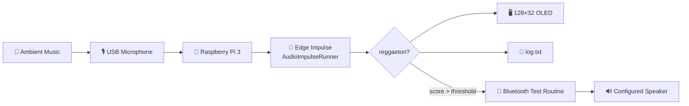
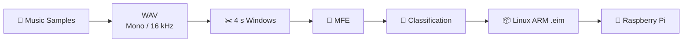
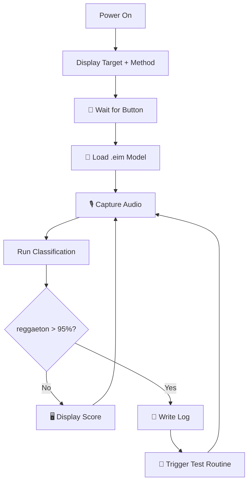

# 🎧🚫 Reggaeton Be Gone

### Edge Machine Learning device that recognizes reggaeton and triggers a Bluetooth test routine on a configured speaker

[](https://www.raspberrypi.com/products/raspberry-pi-3-model-b/)
[](https://edgeimpulse.com/)
[](https://www.python.org/)
[](https://huggingface.co/ronibandini/reggaetonbegone)
[](LICENSE)
[](https://github.com/ronibandini/reggaetonBeGone/stargazers)


**Roni Bandini — Buenos Aires, Argentina — February 2024**

**Reggaeton Be Gone** is an experimental Raspberry Pi device inspired by **TV-B-Gone**.

It continuously samples ambient audio, uses an **Edge Impulse audio-classification model** to determine whether reggaeton is playing, displays the inference confidence on a 128×32 OLED, and—when the configured threshold is exceeded—triggers a Bluetooth test routine against a configured speaker.

The original motivation was simple: a neighboring Bluetooth speaker playing loud reggaeton every morning.

The resulting project combines:

* 🎙️ Audio acquisition
* 🧠 Edge Machine Learning
* 🎵 Music-genre classification
* 🍓 Raspberry Pi
* 📡 Bluetooth experimentation
* 🖥️ OLED feedback
* 📝 Event logging

---

## 🧷 Simpler Alternative: Pocket Gone

A later project explores the Bluetooth side without Machine Learning or a Raspberry Pi.

**Pocket Gone** is smaller, cheaper and portable:

👉 **[pocketgone.com](https://pocketgone.com/)**

The evolution from Reggaeton Be Gone to Pocket Gone was also presented at Nerdearla 2025:

👉 **[Pocket Gone — Nerdearla / NERDflix](https://nerdearla.com/nerdflix/BSzp_WEursA/)**

---

# 🏗️ Architecture



The ML inference runs locally on the Raspberry Pi using an Edge Impulse `.eim` deployment.

---

# ✨ Features

* 🎵 Reggaeton / other-music classification
* 🧠 Edge Impulse Linux inference
* 🎙️ USB microphone or USB audio interface
* 🖥️ 128×32 SSD1306 OLED
* 🔘 Physical start button
* 🎯 Configurable inference threshold
* 📡 Configurable Bluetooth target
* 📝 Timestamped activity log
* 🔬 Multiple experimental Bluetooth methods
* 🧪 Manual `forceFire` test mode
* 🖼️ Custom OLED graphics and font
* 🧱 3D-printed front panel
* 🔄 Several later experimental versions

---

# 🧠 Machine Learning

The original model was trained because common music-genre datasets such as GTZAN did not provide a dedicated reggaeton class.

The workflow was:



Original settings documented for Version 1:

| Parameter         |          Value |
| ----------------- | -------------: |
| Audio             |       Mono WAV |
| Sample rate       |     **16 kHz** |
| Window size       |    **4000 ms** |
| Processing        |        **MFE** |
| Learning block    | Classification |
| Target deployment |      Linux ARM |
| Runtime format    |         `.eim` |

The current source expects:

```python
model = "reggaetonbgone-linux-armv7-v4.eim"
```

---

# 🤗 Public Model

A public reference model is now available on Hugging Face:

👉 **[ronibandini/reggaetonbegone](https://huggingface.co/ronibandini/reggaetonbegone)**

The model card specifies:

```text
Audio: 16 kHz WAV / mono

Labels:
- reggaeton
- otros
```

The published reference model was trained with only **six songs**, so the model card recommends training a larger dataset for improved generalization.

This is particularly important when deploying the classifier in rooms with:

* speech
* television
* other music genres
* different speakers
* background noise
* varying microphone distance

---

# 🎙️ Edge Impulse Linux Runner

The Python application uses:

```python
from edge_impulse_linux.audio import AudioImpulseRunner
```

and initializes the model with:

```python
with AudioImpulseRunner(modelfile) as runner:
    model_info = runner.init()
    labels = model_info['model_parameters']['labels']
```

Audio is continuously classified through:

```python
for res, audio in runner.classifier(
    device_id=selectedDeviceId
):
```

The configured USB input is:

```python
selectedDeviceId = 1
```

Change this value to match the desired microphone/audio interface.

---

# 🎯 Detection Threshold

Version 1.0 currently uses:

```python
threshold = 0.95
```

or:

```text
95% confidence
```

The program specifically watches the:

```text
reggaeton
```

class.

Below the threshold, the OLED displays:

```text
Is reggaeton?
87.42 %
```

The relevant logic is:

```python
if label == 'reggaeton' and score <= threshold:
    updateScreen(
        "Is reggaeton?",
        str(round(score * 100, 2)) + " %"
    )
```

When the threshold is exceeded:

```python
if label == 'reggaeton' and (
    score > threshold or forceFire == 1
):
```

the configured Bluetooth test action is triggered.

---

# ⚙️ Version 1.0 Configuration

The principal settings are grouped near the beginning of:

👉 **[`reggaetonBeGone.py`](https://github.com/ronibandini/reggaetonBeGone/blob/main/reggaetonBeGone.py)**

```python
myPath = "/home/pi/reggaeton/"

selectedDeviceId = 1

method = 1

targetAddr = ":::::"

packagesSize = 800
threadsCount = 1000

threshold = 0.95
myDelay = 0.1

forceFire = 0

model = "reggaetonbgone-linux-armv7-v4.eim"
```

| Setting            | Purpose                     |
| ------------------ | --------------------------- |
| `myPath`           | Runtime asset directory     |
| `selectedDeviceId` | Audio input                 |
| `method`           | Bluetooth experiment mode   |
| `targetAddr`       | Test speaker address        |
| `packagesSize`     | Method-specific parameter   |
| `threadsCount`     | Number of repetitions       |
| `threshold`        | ML confidence threshold     |
| `myDelay`          | Delay between actions       |
| `forceFire`        | Skip ML trigger for testing |
| `model`            | Edge Impulse `.eim`         |

The source code is intended for controlled experimentation with hardware you own.

---

# 🔘 Physical Start Button

The application does not immediately begin audio classification.

GPIO configuration:

```python
GPIO.setmode(GPIO.BCM)

buttonPin = 26

GPIO.setup(
    buttonPin,
    GPIO.IN,
    pull_up_down=GPIO.PUD_UP
)
```

The program waits at:

```text
Waiting for button...
```

until GPIO 26 is pulled LOW.

After the button is pressed:

```text
Listening...
```

and audio inference begins.

---

# 🖥️ OLED Interface

The build uses a monochrome **SSD1306 128×32 OLED**.

```python
disp = Adafruit_SSD1306.SSD1306_128_32(
    rst=None
)
```

The screen displays information such as:

```text
Reggaeton BeGone
Listening...
```

and:

```text
Reggaeton BeGone
Is reggaeton?
92.61 %
```

The UI is rendered using Pillow:

```python
from PIL import Image
from PIL import ImageDraw
from PIL import ImageFont
```

Custom font:

```python
font = ImageFont.truetype(
    'whitrabt.ttf',
    12
)
```

---

# 🔌 Wiring

## OLED

| OLED | Raspberry Pi |
| ---- | ------------ |
| SDA  | GPIO 2       |
| SCL  | GPIO 3       |
| VCC  | Power        |
| GND  | GND          |

Enable I²C with:

```bash
sudo raspi-config
```

and verify the display with:

```bash
i2cdetect -y 1
```

---

## Push Button

| Button | Raspberry Pi |
| ------ | ------------ |
| Pin 1  | GPIO 26      |
| Pin 2  | GND          |

The internal pull-up is enabled in software.

---

## Audio

Connect either:

```text
USB microphone
```

or:

```text
USB audio interface + microphone
```

The original build used a **Behringer Xenyx 302USB**.

---

# 🛠️ Hardware

| Component                                                                      | Quantity |
| ------------------------------------------------------------------------------ | -------: |
| [Raspberry Pi 3](https://www.raspberrypi.com/products/raspberry-pi-3-model-b/) |        1 |
| [DFRobot 128×32 OLED](https://www.dfrobot.com/product-2018.html)               |        1 |
| [DFRobot Push Button](https://www.dfrobot.com/product-1098.html)               |        1 |
| USB microphone / USB audio interface                                           |        1 |
| microSD card                                                                   |        1 |
| 5 V / 3 A power supply                                                         |        1 |
| Female-female jumper wires                                                     |  Several |
| Bluetooth speaker for controlled testing                                       |        1 |
| Custom enclosure/front panel                                                   |        1 |

An optional external Bluetooth adapter can also be used for experimental versions.

---

# 🔄 Runtime Flow



---

# 📝 Logging

Every major operation is written to:

```text
log.txt
```

with a timestamp:

```python
now = datetime.datetime.now()

dtFormatted = now.strftime(
    "%Y-%m-%d %H:%M:%S"
)
```

Events include:

```text
Started
Listening
AI model ...
Firing threshold ...
Interrupted
```

This is useful for comparing inference behavior with the audio being played during experiments.

---

# 📂 Runtime Layout

The code expects a slightly different runtime layout from the flat GitHub repository.

A practical deployment is:

```text
/home/pi/reggaeton/
│
├── reggaetonBeGone.py
├── reggaetonbgone-linux-armv7-v4.eim
├── whitrabt.ttf
├── log.txt
│
└── images/
    └── logo.png
```

This matters because the current source loads:

```python
myPath + 'images/logo.png'
```

while the GitHub repository currently stores `logo.png` at repository root.

Either create the `images/` directory as above or change the image path in the Python source.

---

# 💻 Software Setup

Install Raspberry Pi OS:

👉 **[Raspberry Pi Imager](https://www.raspberrypi.com/software/)**

Enable:

```text
SSH
I²C
```

through:

```bash
sudo raspi-config
```

The application requires:

* Python 3
* Edge Impulse Linux SDK
* PortAudio / PyAudio
* Raspberry Pi GPIO
* Pillow
* Adafruit SSD1306
* Adafruit GPIO
* BlueZ

The original complete dependency procedure is preserved in:

👉 **[Reggaeton Be Gone — Hackster.io](https://www.hackster.io/roni-bandini/reggaeton-be-gone-e5b6e2)**

Edge Impulse Linux SDK:

👉 **[edgeimpulse/linux-sdk-python](https://github.com/edgeimpulse/linux-sdk-python)**

---

# 🚀 Installation

Clone the repository:

```bash
git clone \
https://github.com/ronibandini/reggaetonBeGone.git

cd reggaetonBeGone
```

Repository:

👉 **[github.com/ronibandini/reggaetonBeGone](https://github.com/ronibandini/reggaetonBeGone)**

Prepare the runtime assets:

```text
logo.png
whitrabt.ttf
Edge Impulse .eim model
```

Then configure:

```python
myPath
selectedDeviceId
threshold
targetAddr
method
```

in:

👉 **[`reggaetonBeGone.py`](https://github.com/ronibandini/reggaetonBeGone/blob/main/reggaetonBeGone.py)**

Run the application in a controlled test environment with your own Bluetooth speaker.

---

# 📁 Repository Structure

```text
reggaetonBeGone/
│
├── reggaetonBeGone.py
├── README.md
├── LICENSE
│
├── logo.png
├── sticker.png
├── whitrabt.ttf
└── log.txt
```

* 🐍 **[`reggaetonBeGone.py`](https://github.com/ronibandini/reggaetonBeGone/blob/main/reggaetonBeGone.py)** — Version 1.0 application
* 📝 **[`log.txt`](https://github.com/ronibandini/reggaetonBeGone/blob/main/log.txt)** — sample runtime log
* 🖼️ **[`logo.png`](https://github.com/ronibandini/reggaetonBeGone/blob/main/logo.png)** — OLED graphic
* 🏷️ **[`sticker.png`](https://github.com/ronibandini/reggaetonBeGone/blob/main/sticker.png)** — enclosure artwork
* 🔤 **[`whitrabt.ttf`](https://github.com/ronibandini/reggaetonBeGone/blob/main/whitrabt.ttf)** — display font
* ⚖️ **[`LICENSE`](https://github.com/ronibandini/reggaetonBeGone/blob/main/LICENSE)** — MIT License

---

# 🧪 Versions

## Version 1.0 — February 2024

The version available in this GitHub repository.

Features:

```text
Raspberry Pi 3
Edge Impulse audio classification
128×32 OLED
GPIO start button
Configured Bluetooth target
Two experimental test methods
Activity log
```

Source:

👉 **[Version 1.0 — GitHub](https://github.com/ronibandini/reggaetonBeGone)**

---

## Version 2.0 — April 2024

Released to participants of the **Nerdearla Chile 2024** workshop.

Improvements documented by the author include:

```text
64-bit support
On-device Bluetooth scanning
Strike system to reduce false positives
Process cleanup
Updated ML model
```

Workshop:

👉 **[Reggaeton Be Gone — Nerdearla / NERDflix](https://nerdearla.com/nerdflix/sPcHeiP9Xgg/)**

Background:

👉 **[Workshop Reggaeton Be Gone en Nerdearla Chile — Medium](https://bandini.medium.com/workshop-reggaeton-be-gone-en-nerdearla-chile-39c517c63889)**

---

## Version 3.0 — November 2024

Created for the **Ekoparty 2024** workshop.

The experimental release added further scanning, model and external-radio improvements.

Workshop announcement:

👉 **[Cómo armar un Reggaeton Be Gone en Ekoparty](https://www.youtube.com/watch?v=YlZ697iBGJ0)**

More version history:

👉 **[Reggaeton Be Gone — Medium](https://bandini.medium.com/reggaeton-be-gone-6fa55f46a9d7)**

---

# 🎥 Videos & Talks

## Nerdearla Chile 2024

Complete Spanish workshop covering:

* hardware
* Machine Learning
* assembly
* limitations
* Version 2.0

▶️ **[Reggaeton Be Gone — NERDflix](https://nerdearla.com/nerdflix/sPcHeiP9Xgg/)**

---

## YouTube Workshop

▶️ **[Reggaeton Be Gone — Spanish Workshop](https://www.youtube.com/watch?v=sPcHeiP9Xgg)**

---

## Nerdearla Argentina 2025

The later talk follows the evolution from **Reggaeton Be Gone** to **Pocket Gone**.

▶️ **[Pocket Gone y la aventura de silenciar parlantes](https://nerdearla.com/nerdflix/BSzp_WEursA/)**

---

# 🌐 External References

## 🛠️ Hackster.io — Full Tutorial

The original February 26, 2024 build documents the circuit, Raspberry Pi configuration, ML training, audio input, OLED interface and enclosure.

👉 **[Reggaeton Be Gone — Hackster.io](https://www.hackster.io/roni-bandini/reggaeton-be-gone-e5b6e2)**

---

## 🇦🇷 Medium — Original Article

Detailed development history, versions, ML workflow, results, conferences and press coverage.

👉 **[Reggaeton Be Gone — Roni Bandini / Medium](https://bandini.medium.com/reggaeton-be-gone-6fa55f46a9d7)**

---

## 🤗 Public Model

16 kHz mono Edge Impulse model with `reggaeton` and `otros` labels.

👉 **[Reggaeton Be Gone Model — Hugging Face](https://huggingface.co/ronibandini/reggaetonbegone)**

---

# 📰 Press

## WIRED

Published February 27, 2024.

👉 **[Reggaeton Be Gone, la máquina impulsada por IA que bloquea bocinas Bluetooth — WIRED](https://es.wired.com/articulos/reggaeton-be-gone-la-maquina-impulsada-por-ia-que-bloquea-bocinas-bluetooth-que-reproducen-regueton)**

---

## Hackaday

Published February 23, 2024.

👉 **[Reggaeton-Be-Gone Disconnects Obnoxious Bluetooth Speakers — Hackaday](https://hackaday.com/2024/02/23/reggaeton-be-gone-disconnects-obnoxious-bluetooth-speakers/)**

---

## Hackster News

👉 **[Pardon the Interruption — Hackster](https://www.hackster.io/news/pardon-the-interruption-ba1621756255)**

---

## Tom's Hardware

Published February 28, 2024.

👉 **[La musica del vicino è fastidiosa? Ecco la soluzione da hacker — Tom's Hardware](https://www.tomshw.it/hardware/la-musica-del-vicino-e-fastidiosa-ecco-la-soluzione-da-hacker)**

---

## Euronews

Published April 9, 2024.

👉 **[Reggaeton Be Gone: esta máquina casera silencia la música de los vecinos usando IA — Euronews](https://es.euronews.com/next/2024/04/09/reggaetonbe-gone-esta-maquina-casera-silencia-la-musica-de-los-vecinos-usando-ia)**

---

## Univision

👉 **[Latino crea aparato para hackear y apagar bocinas que reproduzcan reggaetón — Univision](https://www.univision.com/entretenimiento/cultura-pop/roni-bandini-creador-aparato-anti-reggaeton-en-bocinas-como-funciona)**

---

## La Nación

Feature on maker culture, Reggaeton Be Gone and other experimental machines.

👉 **[Roni Bandini, el creador de la antena anti reggaeton — La Nación](https://www.lanacion.com.ar/tecnologia/este-sabado-una-charla-de-roni-bandini-el-creador-de-la-antena-anti-reggaeton-y-del-portero-que-nid27092024/)**

---

# 🔗 Related GitHub Projects

### 🎙️ Photon 2 Voice Command

Audio keyword recognition with Edge Impulse running directly on a Particle Photon 2.

👉 **[github.com/ronibandini/Photon2VoiceCommand](https://github.com/ronibandini/Photon2VoiceCommand)**

### 📚 Reading Time

Audio TinyML on Arduino Nano 33 BLE Sense for recognizing the sound of paper page turns.

👉 **[github.com/ronibandini/ReadingTime](https://github.com/ronibandini/ReadingTime)**

### 🚦 TI AM62A AI Traffic Light

Computer Vision inference connected to a physical control system.

👉 **[github.com/ronibandini/TIAM62AITrafficLight](https://github.com/ronibandini/TIAM62AITrafficLight)**

### 🔊 Domestic ML LRAD

Audio output triggered by Edge Impulse Computer Vision classification.

👉 **[github.com/ronibandini/domesticLMLRAD](https://github.com/ronibandini/domesticLMLRAD)**

---

# 📕 Contracultura Maker

**Contracultura Maker** is a book by Roni Bandini about maker culture, experimental electronics, AI, physical computing and technological autonomy.

Reggaeton Be Gone is one of the projects connected with this approach to building deliberately unusual technological artifacts.

📂 **[Contracultura Maker — GitHub repository](https://github.com/ronibandini/ContraculturaMaker)**

📕 **[Download Contracultura Maker PDF](https://github.com/ronibandini/ContraculturaMaker/raw/refs/heads/main/ContraculturaMaker2.pdf)**

---

# 📬 Contact

**Roni Bandini**
Maker · AI Developer · Writer
Buenos Aires, Argentina

* 🐙 [GitHub — @ronibandini](https://github.com/ronibandini)
* 🌐 [Medium — @ronibandini](https://bandini.medium.com/)
* 𝕏 [X / Twitter — @RoniBandini](https://x.com/RoniBandini)
* 📸 [Instagram — @ronibandini](https://www.instagram.com/ronibandini/)
* ▶️ [YouTube — @RoniBandini](https://www.youtube.com/@RoniBandini)
* 💼 [LinkedIn — Roni Bandini](https://www.linkedin.com/in/ronibandini/)

---

Built with 🎵 + Raspberry Pi + Edge Machine Learning + Bluetooth.
